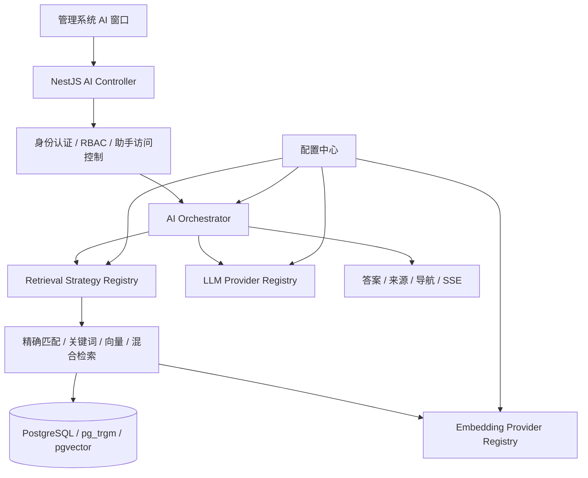

# 管理系统 AI 助手基础架构与开发规范

版本：V1.0 | 状态：开发设计基线

## 1. 项目目标

在现有 Node.js + NestJS + PostgreSQL 管理系统内建设统一 AI Engine，第一阶段提供系统操作问答，后续支持多模型、多知识库、多助手、业务查询和受控操作执行。优先复用现有基础设施，降低 API、服务器及维护成本。

## 2. 技术约束

- 使用 TypeScript、NestJS、现有 PostgreSQL 和现有 ORM、迁移机制、RBAC、日志及异常处理规范。
- 不引入 Python、FastAPI、LangChain、LlamaIndex、Dify、MaxKB 等框架或平台；不默认新增 Redis、独立向量数据库或微服务。
- 模型调用使用 OpenAI Node.js SDK 或统一 HTTP 适配器。LLM 与 Embedding 独立配置。
- 第一阶段使用精确匹配及 PostgreSQL pg_trgm（环境支持时）；向量检索为可选扩展，启用时使用 pgvector。
- 禁止为实现 AI 功能重构无关业务模块；不得假定项目使用某种 ORM 或权限字段。
- 现有前端有页面示例，src\pages\chatbot\index.tsx，可参考。

## 3. 总体架构



业务鉴权、知识检索、模型调用、答案生成分别独立。模型不得承担权限判断。所有外部模型调用必须经过统一 Provider 层。

## 4. 模块划分

建议目录（根据现有项目规范调整）：

```text
src/ai/
  ai.module.ts
  assistant/       # 助手配置与访问控制
  chat/            # 问答编排、SSE
  knowledge/       # 知识库、文档、切片、权限关联
  retrieval/       # 策略接口、注册表、检索实现
  providers/       # LLM / Embedding 接口及适配器
  models/          # 服务商、模型配置与连接测试
  conversation/    # 会话、消息
  usage/           # 用量、审计、限额
  common/          # DTO、类型、错误定义
```

模块之间通过明确接口依赖，Controller 不直接调用数据库或第三方模型。避免循环依赖。

## 5. 扩展接口

以下为接口设计示意，按现有代码风格完善类型和错误处理。

```typescript
interface LlmProvider {
  chat(request: ChatRequest): Promise<ChatResponse>;
  stream(request: ChatRequest): AsyncIterable<ChatEvent>;
}
interface EmbeddingProvider {
  embed(text: string): Promise<number[]>;
  embedBatch(texts: string[]): Promise<number[][]>;
}
interface RetrievalStrategy {
  search(context: RetrievalContext): Promise<RetrievalHit[]>;
}
```

RetrievalContext 包含由服务端生成的 userId、tenantId（若系统有租户）、授权知识库范围、实际权限、question、topK 和策略参数。RetrievalHit 包含 chunkId、documentId、内容、相关度、来源和导航标识。

Provider Registry 按协议类型解析适配器，按配置 ID 创建客户端；第一版实现 OpenAI Compatible 适配器，支持独立的 LLM 与 Embedding 客户端。配置变更后使对应客户端缓存失效。新服务商若遵循已支持协议，仅新增配置即可；新协议需要新增适配器，新检索算法需要新增策略，不修改核心编排逻辑。

## 6. 数据模型

以下为逻辑表设计，不要求一次性建完。主键、审计字段、软删除、租户字段遵循现有项目规范。

| 表 | 核心字段与用途 | 阶段 |
|---|---|---|
| ai_provider | name, protocol, base_url, encrypted_api_key, enabled, timeout | 2 |
| ai_model | provider_id, model_name, model_type, dimensions, parameters, enabled | 2 |
| ai_knowledge_base | name, description, enabled, tenant_id（如适用） | 1 |
| ai_knowledge_document | knowledge_base_id, title, content, route, status, version | 1 |
| ai_knowledge_chunk | document_id, content, keywords, sequence, version | 1 |
| ai_knowledge_permission | document_id, permission_code | 1 |
| ai_assistant | name, enabled, prompt, llm_model_id（可空）, retrieval_config | 1/2 |
| ai_assistant_knowledge_base | assistant_id, knowledge_base_id | 1 |
| ai_assistant_permission | assistant_id, permission_code | 1 |
| ai_conversation | assistant_id, user_id, tenant_id, title | 1 |
| ai_message | conversation_id, role, content, source_refs, status | 1 |
| ai_usage_log | user_id, assistant_id, model_id, tokens, latency, status, request_id | 2 |
| ai_knowledge_embedding | chunk_id, model_id, model_revision, content_version, embedding, status | 3 |

知识条目按功能操作拆分，优先支持结构化标题、标准问题、同义词、操作步骤、权限标识和页面导航。切片继承文档权限。公开知识必须显式标记，缺少权限配置默认拒绝；多权限默认全部满足（如业务要求 ANY，须明确配置）。

向量与内容分离。不同模型及版本的向量不可混用。不同维度采用按模型/维度分区或独立向量表、索引；迁移时先构建新向量，再切换生效配置。不要直接将所有模型塞入固定 vector(1024) 字段。

## 7. 问答流程与检索策略

1. 验证用户身份、助手访问权限及会话归属，获取当前有效业务权限。
2. 计算助手知识库范围与用户授权范围的交集。
3. 标准问题精确匹配；唯一且可靠命中时直接返回授权操作说明，不调用模型。
4. 关键词、同义词及 pg_trgm 模糊检索；高置信度且无歧义时直接返回，歧义时提供候选或追问。
5. 若启用向量检索，使用指定 Embedding 模型向量化问题，在授权范围内检索，必要时与关键词结果融合。
6. 若有足够授权证据且启用 LLM，将授权内容作为不可信参考数据传给模型，生成回答；无可靠证据时拒绝编造，不调用模型进行无依据回答。
7. 返回答案、来源和服务端校验的导航链接，记录审计及用量。

中文检索不能仅依赖 PostgreSQL 默认英文全文检索；维护业务关键词、同义词及实际中文测试集。相似度阈值按策略分别评估，不将不同检索算法的原始分数直接比较。Top-K 默认 4，可配置。混合检索可采用 RRF。小规模知识库先精确向量检索，必要时再引入 HNSW；注意近似索引与权限过滤结合可能导致召回不足。

## 8. 权限与安全（强制）

- 所有检索策略在数据库查询中实施租户、助手范围、文档状态、业务权限过滤，禁止先把未授权内容交给 LLM 再判断权限。
- 权限来源只能是现有服务端身份与 RBAC 服务，不信任前端提交的 userId、tenantId、permissions。
- 知识管理、模型配置、助手管理分别设置管理权限；用户只能访问自己的授权会话。
- 多轮历史和来源引用须按当前权限重新校验。权限撤销后不得通过旧会话、缓存或引用继续读取敏感知识；无法可靠追踪来源的历史上下文应舍弃。
- 模型提示词要求基于证据回答，知识和用户输入均视为不可信数据。Prompt 不是安全边界。
- API Key 加密存储，禁止返回明文或写入日志；配置 Base URL 时限制协议、目标主机和网络范围，防止 SSRF，内部模型地址使用显式白名单。
- 参数化 SQL；限制输入长度、Top-K、上下文长度、并发、请求超时、Token 额度；处理断开连接与取消请求。
- 外部模型仅接收必要且允许外发的数据，避免敏感业务信息进入第三方服务。
- 功能导航地址从授权知识或业务路由表生成；实际业务接口仍须独立鉴权。第一版禁止 AI 直接执行 SQL 或业务写操作。
- 无匹配结果时统一返回“暂无您可访问的相关操作指南”，避免泄露未授权功能是否存在。

## 9. 配置驱动

示例助手配置（引用数据库配置 ID，而非直接保存密钥）：

```json
{
  "name": "系统操作助手",
  "knowledgeBaseIds": ["system-guide"],
  "retrieval": {
    "exact": true,
    "keyword": true,
    "vector": false,
    "topK": 4
  },
  "llm": {"enabled": true, "modelId": "deepseek-chat"},
  "embedding": {"enabled": false, "modelId": null},
  "answerMode": "direct-first"
}
```

支持多个 Provider、模型、知识库和助手；每个助手独立配置提示词、访问权限、检索策略、模型及限额。LLM 未配置或禁用时仍可使用确定性问答。向量策略未实现、扩展不可用或向量未就绪时禁止启用。配置变更需校验并审计，单次请求使用一致的配置快照。故障切换仅在预先配置且符合数据外发政策的模型间进行，流式输出开始后不得静默拼接另一模型的回答。

## 10. API 设计建议

路由前缀按现有项目约定调整。

| 方法 | 路由 | 用途 |
|---|---|---|
| GET | /ai/assistants | 当前用户可访问助手 |
| POST | /ai/chat | 提问，支持 SSE |
| GET | /ai/conversations | 当前用户会话 |
| GET | /ai/conversations/:id/messages | 会话消息 |
| DELETE | /ai/conversations/:id | 删除会话 |
| GET/POST | /ai/admin/knowledge-bases | 知识库列表/创建 |
| GET/POST | /ai/admin/documents | 知识列表/创建 |
| PATCH/DELETE | /ai/admin/documents/:id | 更新/删除知识 |
| GET/POST | /ai/admin/providers | 服务商管理 |
| POST | /ai/admin/providers/:id/test | 测试连接 |
| GET/POST | /ai/admin/models | 模型管理 |
| GET/POST | /ai/admin/assistants | 助手管理 |

管理资源补充必要的详情、更新、禁用接口。统一复用现有 DTO 校验和异常规范。

POST /ai/chat 请求示例：

```json
{"assistantId":"system-guide","conversationId":null,"question":"如何新增设备？"}
```

SSE 事件建议：meta（会话/请求 ID）、delta（文本片段）、sources（授权来源及导航）、done（状态及用量）、error（脱敏错误）。POST 流式请求使用 fetch 读取响应流；避免依赖只支持 GET 的原生 EventSource。客户端断开时取消上游调用；直接命中也使用统一事件协议。

## 11. 管理后台

在现有后台增加 AI 管理菜单：知识库管理（CRUD、权限绑定、关键词、操作说明、发布状态）；模型服务商管理（协议、地址、密钥、连接测试）；模型管理（LLM/Embedding 类型、模型名称、维度）；助手管理（知识库关联、访问权限、策略、提示词）；会话及用量审计（按权限查看）。第一阶段仅建设实际启用的功能，不实现空壳管理页面。

## 12. 成本与可靠性

默认 direct-first，标准问题无需模型调用。知识修改后才重新向量化，批量任务按内容版本幂等执行；问题向量缓存按模型版本区分。答案缓存如需引入，必须隔离租户、授权范围、知识版本及配置版本。记录真实 Token 用量，供应商未返回时标记未知，不伪造精确成本。配置请求限额、超时、有限重试及失败降级。模型不可用时仍可返回可靠的授权标准答案。

## 13. 分阶段实施

### 阶段 1：零额外模型 API 成本的基础问答
- 调研现有项目；实现知识库、助手、权限关联、精确及关键词检索、基础会话和统一回答协议。
- 验收：授权用户得到正确操作步骤，未授权用户无知识泄露；不配置模型即可运行。

### 阶段 2：多模型接入
- 实现 Provider Registry、OpenAI Compatible 适配器、模型配置、LLM 生成、SSE 和用量记录。
- 验收：后台新增兼容模型并切换助手模型，无需修改代码或重新部署；禁用模型仍可使用标准问答。

### 阶段 3：语义检索
- 启用 pgvector、Embedding Provider、向量化任务、版本管理、向量及混合检索。
- 验收：语义改写问题可命中；不同模型向量隔离；权限过滤及知识更新生效。

### 阶段 4：高级扩展
- 多助手完善、限额、故障切换、检索评估、可选 Rerank。
- 后续业务查询和 Function Calling 独立设计工具注册、参数校验、逐次鉴权、审计及写操作确认，不在基础版实现。

## 14. 测试与验收

至少覆盖：精确命中、中文同义词、无相关知识、歧义问题、无权限、跨租户（如适用）、多助手范围交集、权限撤销后旧会话、提示词注入、禁用知识、模型超时、流式中断、配置切换、密钥脱敏、SSRF 拦截。向量阶段补充维度不匹配、版本迁移、向量未就绪及权限过滤后的召回测试。使用 mock Provider 完成自动化测试，不依赖付费 API。

## 15. 给 AI 编程工具的执行指令

1. 首先阅读现有项目结构、package.json、ORM 配置、数据库迁移、认证 Guard、RBAC 实现及前端管理模块；不得臆造已有接口。
2. 输出项目现状分析、可复用组件、拟新增文件和阶段 1 实施计划；若存在关键缺失信息，先询问。
3. 默认仅实施阶段 1，待确认后逐步实现后续阶段。保留清晰扩展接口，不提前实现复杂平台或所有预留表。
4. 所有数据库变更通过现有迁移机制执行，不删除或破坏已有数据；不得擅自安装数据库扩展或在生产环境执行迁移。
5. 每次修改提供变更说明、测试结果和必要配置；遵循项目代码规范，不重构无关模块，不硬编码密钥、模型、权限或租户。
6. 优先确保权限安全、可测试性及低成本，其次才是模型能力。无法确认的业务规则应明确列出，不自行猜测。

最终目标：一个可独立演进、配置驱动的 NestJS AI Engine，而非依赖第三方 AI 管理平台的聊天功能。
